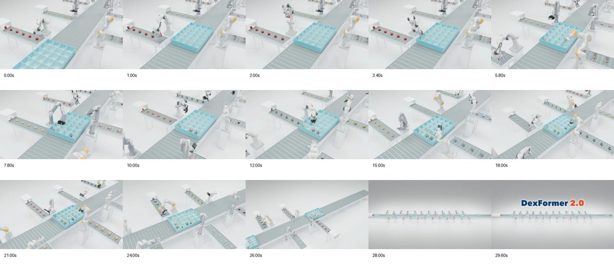

# DexFormer 2.0

> **Project status / 项目状态**
>
> This repository currently contains only the rendering scripts and supporting recorded trajectories for DexFormer 2.0 promotional videos. The full project code will be organized and added here in a future update.
>
> 目前仓库仅包含 DexFormer 2.0 宣传视频的渲染脚本及配套轨迹数据，后续会将完整项目代码整理并更新到此仓库。

[Project website](https://davidlxu.github.io/dexformer2-web/) · [Website source](https://github.com/DavidLXu/dexformer2-web)

Native Blender rendering recipes for **five DexFormer 2.0 demonstration films**, plus individual apple-grasp exports for all **24 arm–hand combinations**. The repository contains recorded trajectories, camera/reveal choreography, scene assembly, bounded-memory rendering, video encoding, and playback-speed annotations.

**This is a rendering/replay repository.** Selected successful independent rollouts are staged into scenes. Depending on the recording, transfer/release uses external IK and scripted control. Camera motion, repeated packing cycles and conveyor scheduling are scripted. The films are illustrative demonstrations, not simultaneous multi-robot evaluations or success-rate evidence. See [control boundaries](docs/control-boundaries.md).

**Availability:** scripts and selected numeric trajectories are included. Exact robot/object mesh and texture files are **not bundled or publicly hosted by this repository**; their provenance and hashes are included. Full native scenes require a separately supplied compatible asset bundle. The Newton tree can be downloaded automatically from Poly Haven. A checkpoint is unnecessary for replay; policy re-capture requires the separately obtained policy runtime and weights. See [assets and checkpoints](docs/assets.md).

## Films

| Recipe | Film | Default output |
|---|---|---|
| `conveyor` | One station → one row → 60-station production floor | 14.8 s, 30 fps |
| `newton` | Textured tree, falling apple, then native robot grasp reveal | 14.8 s, 30 fps |
| `ring` | Four objects per station, coordinated circular collection | 15 s, 60 fps |
| `long-table` | 24 alternating robots along a table; forward descending camera | 15 s, 60 fps |
| `order-packing` | 24 configurations, extended side feeders, boxes five stations apart | 30 s, 30 fps |
| `apples` | One file per configuration grasping an apple at 0.5× | 24 short clips, 30 fps |

The ring recipe contains 12 successful configurations across four arms and five hands; RAPID is not part of that selected four-object sequence. The other recipes use their own recorded selections.



[View all film previews](docs/gallery.md) · [Release validation](docs/validation.md)

## Install

Use a source checkout and Python **3.11**, with Blender's `bpy` **4.5.3** runtime:

```bash
git clone https://github.com/DavidLXu/dexformer2.git
cd dexformer2
python3.11 -m venv .venv
source .venv/bin/activate
python -m pip install -e '.[render,dev]'
dexvideo list
```

Editable installation is intentional: recipes, manifests and trajectories remain in this checkout. GPU rendering is optional; CPU is the conservative default. Linux NVIDIA users can request `--device OPTIX`; supported Apple systems can request `--device METAL`.

## Prepare assets

```bash
# Import an existing compatible native bundle. Files are hash-checked.
dexvideo import-assets /path/to/native-render-bundle
# Newton only: download the pinned CC0 tree and textures.
dexvideo fetch-tree
dexvideo doctor
```

The required bundle schema and upstream sources are described in [docs/assets.md](docs/assets.md). An absent bundle produces an explicit error; the code does not substitute approximate robot meshes. `work/`, checkpoints, videos and imported assets are excluded from Git.

## Build, preview, render

```bash
# Build the 30-second packing scene and verify feed/tray/trajectory constraints.
dexvideo build order-packing
# Small native preview; no full-film render required.
dexvideo render order-packing --preview --frames 1,391,900 --device CPU
# Render full-resolution frames in fresh processes every eight frames.
dexvideo render order-packing --device OPTIX --batch 8
dexvideo encode order-packing
```

Add truthful per-action speed annotations to the matching 30-second packing film:

```bash
dexvideo annotate-speed work/packing/order-packing.mp4
```

The overlay reads the scene's generated timing audit. It shows the focused station's rate and an active-station range in the overview; it is not a global multiplier for the camera or conveyors.

The other films use the same commands. `dexvideo run ring --device OPTIX` builds, renders and encodes. Native scenes keep a 30 fps animation timebase; 60 fps output samples genuine half-frame scene states, rather than duplicating frames. Newton assembles several reveal layers before encoding.

For the apple exports:

```bash
for i in $(seq 0 23); do
  dexvideo run apples --index "$i" --device OPTIX
done
```

Use `DEXVIDEO_WORK=/path/to/output-root` to place work files elsewhere. Use a different work directory for a new rendering configuration. Existing frames are reused only when render settings match and the image is valid. Start with one worker; the original long-lived parallel jobs suffered memory growth, so this implementation resets Blender after small batches.

## What is stored here?

- `recipes/`: ported final scene builders and the upstream scene stages they need.
- `src/dexvideo/`: portable CLI, asset import, native renderer and encoder.
- `trajectories/`: original selected joint/object recordings; checksums remain unchanged.
- `manifests/`: selections, checkpoint identity, asset provenance/hashes and recipe lineage.
- `docs/`: control assumptions, external dependencies, preview gallery and validation.

No SSH credentials, server access scripts, training logs, private handoff documents, paper sources or machine-specific home paths are part of the release.

## 中文说明

这是五类视频及 24 构型抓苹果视频的独立渲染仓库。它保留真实录制的动作轨迹，负责场景、运镜、显隐、变速和视频导出。

**只渲染已有轨迹不需要 checkpoint。** 重新运行模型录制动作才需要模型权重、policy 代码、仿真环境与物理资产。当前仓库提供权重版本和 SHA-256，不提供权重下载。

机械臂、手、物体的网格和材质具有不同许可，当前以来源和校验清单管理，需自行提供兼容资产包。树木提供下载命令。第三方资产没有被统一改成 MIT。完整影片复现的前提与缺失项见 [资产说明](docs/assets.md)。

## License

Repository-authored code: [MIT](LICENSE). Numeric trajectory recordings: [CC BY 4.0](trajectories/LICENSE.txt). Third-party assets and trademarks retain their original terms; the code license does not cover them.
