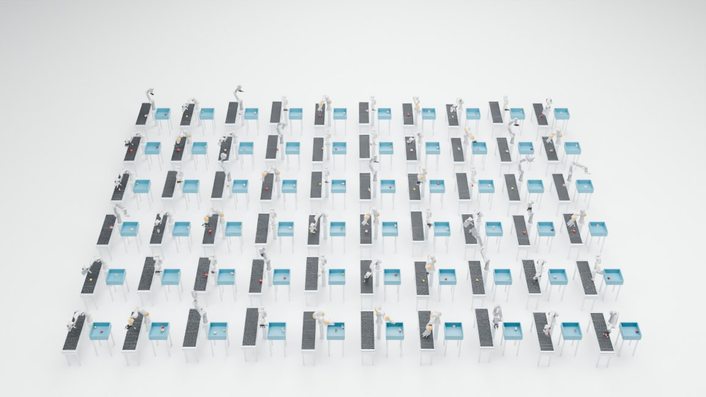
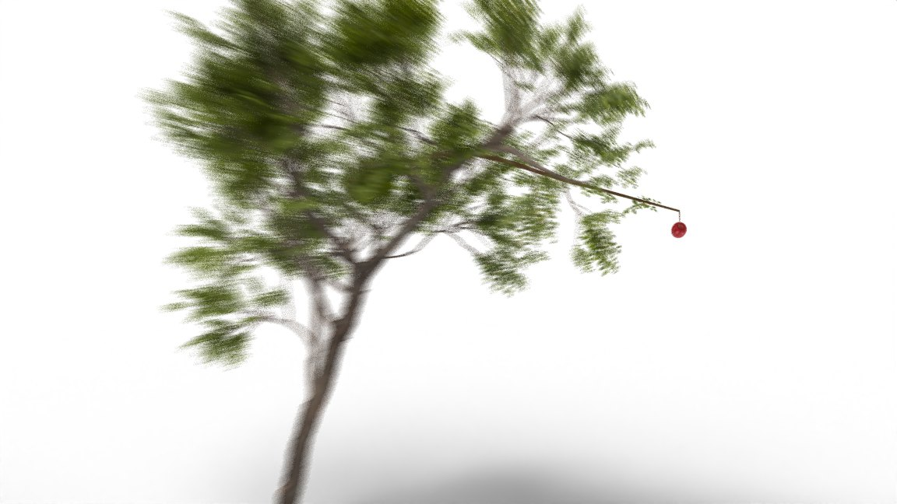
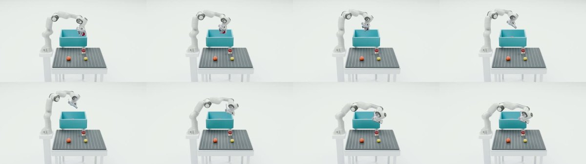
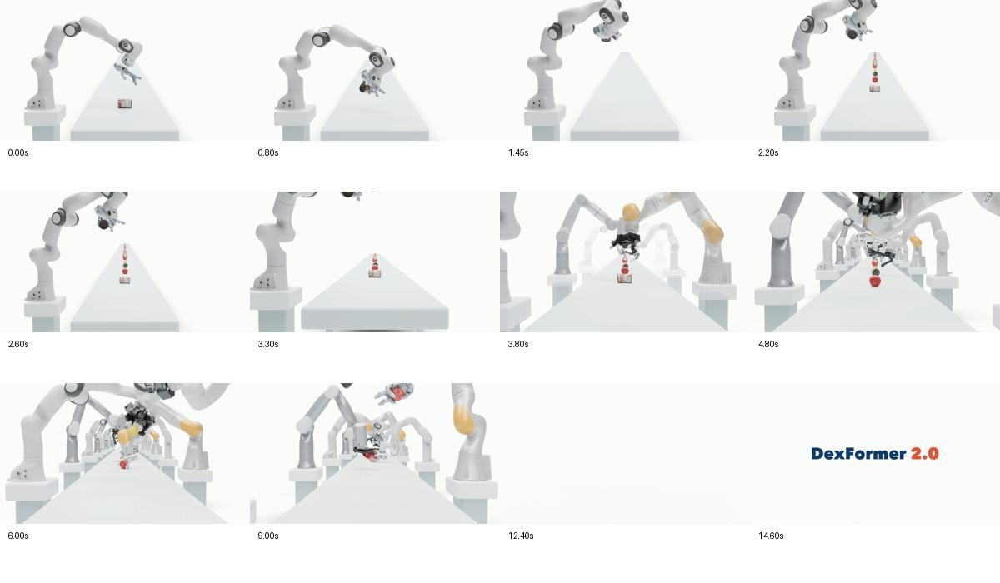
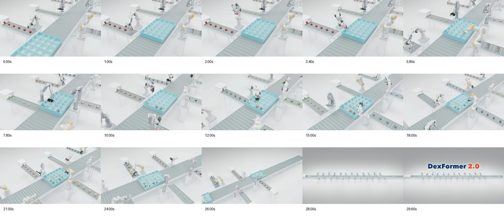

# Film gallery

These previews are from the approved films; rebuilding uses the ported native recipes.

## Conveyor formation

60 stations, first Franka + Revo3, row-first reveal and front-to-back expansion. Two recorded targets per station.

## Newton prologue

Textured tree, a scripted falling apple and a continuous camera handoff to the recorded robot-grasp sequence.

## Circular collection

Four-object sequences on 12 selected configurations, coordinated variable playback, 60 fps native scene sampling.

## Long-table relay

24 configurations, staged object/robot reveals, fixed opening and forward-descending straight camera.

## Continuous order packing

30 seconds, 24 object types, longer side feeders and seven boxes five stations apart. Optional actual per-action speed annotations.
